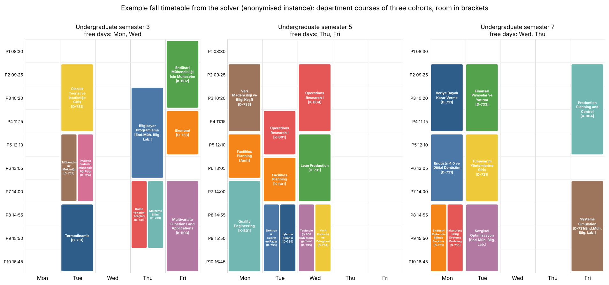

# University course timetabling with CP-SAT

A complete, configurable timetabling system for a university department. It places every theory,
application and lab block of about fifty undergraduate and graduate courses into a five-day,
thirteen-period week, assigns rooms (classrooms, a shared computer lab and amphitheatres granted by
the faculty), respects instructor availability and the common courses the faculty fixes in advance,
and gives students and instructors as many free days as possible. The model is solved with
[Google OR-Tools CP-SAT](https://developers.google.com/optimization/cp/cp_solver); the result is a
formatted Excel workbook with one sheet per cohort, room and instructor, plus a CSV file.

The system was built to produce the real timetable of an industrial engineering department in
Türkiye. This repository ships an **anonymised example instance**: course names and rooms follow
the real curriculum, instructor names are replaced by codes (`Öğr. Üyesi 01` ...) and their
availability is synthetic. Input files, sheet names and day names are in Turkish, as in production.

## What the model handles

Hard constraints (numbered as in the [model document](docs/matematiksel_model.pdf)):

| | Constraint |
|---|---|
| K1 | Time windows: no 08:30 start (configurable), a latest period, campus-wide blocked slots (e.g. Friday prayer), per-course day and period windows, instructor availability |
| K2 | One block per room at a time; room pools by programme level; lab-only courses; courses that need a classroom and the lab at the same time; amphitheatre courses in faculty-granted rooms and time windows |
| K3 | One block per instructor at a time, including the faculty's fixed sessions; an assistant can run the application hours |
| K4 | No clashes within a student cohort (programme level x semester) |
| K5 | Elective groups with dynamic pairing: any two electives of a group may share a slot, the solver chooses the pairing, and at least *k* distinct slots remain so students can still pick *k* courses |
| K6 | At most *N* electives of a cohort run in parallel |
| K7 | Structural rules: consecutive blocks of a course stay in one room, single-block courses, same-day and different-day courses, pinned sessions |
| K8 | Every cohort keeps at least one completely free weekday |

The objective is a weighted sum that approximates a lexicographic order:

| Weight | Criterion |
|---:|---|
| 1000 | free weekdays per student cohort |
| 500 | concentrate each instructor's teaching on as few days as possible |
| 300 | cohort day preferences |
| 10 | in-day gaps for a representative student |
| 5 | penalty for pairing electives in one slot (only when it buys something) |
| 2 | room preference order |

An independent checker re-verifies every hard constraint on the solution; `src.main` exits with a
non-zero code if it finds a violation. The full formulation (sets, parameters, decision variables,
constraints K1-K8 and the objective) is in [docs/matematiksel_model.pdf](docs/matematiksel_model.pdf)
(in Turkish; LaTeX source alongside).

## Quick start

    pip install -r requirements.txt
    python -m src.main                       # fall term -> timetable_v1.xlsx, schedule_v1.csv
    python -m src.main --term BAHAR --config config_bahar.yaml --availability availability_bahar.yaml

Useful options: `--time-limit` (seconds, default 7200; the solver stops earlier once optimality is
proven), `--workers` (default 1, which makes runs deterministic; 0 uses all cores), `--no-optimize`
(feasibility only), `--out` and `--csv` (output paths).

Run the tests (89 tests, about one minute):

    python -m pytest -q

## Example output

[`examples/timetable_guz.xlsx`](examples/timetable_guz.xlsx) and
[`examples/schedule_guz.csv`](examples/schedule_guz.csv) were produced from the example instance
with `python -m src.main --time-limit 420`: all 48 course components placed, the checker found no
violation, and every undergraduate cohort shown above keeps two free weekdays. The workbook has one
sheet per cohort, room and listed instructor, plus summary sheets by instructor, by room and of
external dependencies.

## Inputs

| File | Content |
|---|---|
| `data/courses.xlsx` | Course master, sheet `Sayfa1`: term (`DÖNEM`), level (`Kategori`: Lisans, YL, DR), semester, code, name, instructor, theory/application/lab hours (`T`, `U`, `L`), compulsory or elective, enrolment, department flag |
| `data/faculty_rooms.xlsx` | Faculty room programme, sheets `Derslik Programı Güz` and `Derslik Programı Bahar`: one block per room with periods x weekdays. Cells that mention the department become fixed sessions; other bookings in the department's rooms become blocked intervals |
| `config.yaml`, `config_bahar.yaml` | Rooms, elective groups, weights and course rules for each term |
| `availability.yaml`, `availability_bahar.yaml` | Windows in which each instructor cannot teach |

Main configuration keys:

| Key | Meaning |
|---|---|
| `room_pools`, `room_priority`, `lab_room`, `amfi_room` | rooms available per level and their preference order |
| `amfi_courses`, `amfi_assignments`, `room_windows` | large courses, the faculty rooms granted to them and the windows in which those rooms are free |
| `lab_courses`, `lab_only_courses`, `dual_room_courses`, `course_rooms` | lab and room requirements per course |
| `groups` | elective groups: `course: [group, k]` |
| `max_parallel_electives` | K6 capacity |
| `same_day_courses`, `different_day_courses`, `single_block_courses`, `split_tu` | structural rules |
| `course_days`, `course_windows`, `cohort_days`, `cohort_day_pref` | day and period restrictions and preferences |
| `forbid_first_period`, `allow_first_courses`, `latest_period`, `blocked_slots`, `require_free_day` | global time rules |
| `fixed_placements`, `fixed_session_cohorts`, `fixed_session_groups`, `default_pin_cohort` | pinned sessions and the cohort/group of the faculty's fixed sessions |
| `instructor_overrides`, `uygulama_assistants`, `hide_instructors`, `instructor_sheets` | instructor assignment and output options |
| `weights` | objective weights |

## Code layout

| Module | Role |
|---|---|
| `src/data_loader.py` | reads the course master and the faculty room programme |
| `src/domain.py` | courses, schedulable components (T+U together, lab apart, optional splits) |
| `src/config.py` | configuration and availability |
| `src/model.py`, `src/solve.py` | CP-SAT model and solver call |
| `src/checker.py` | independent verification of every hard constraint |
| `src/render_xlsx.py`, `src/reports.py` | Excel workbook and CSV output |
| `src/main.py` | command-line entry point |

## Author

Tarık Küçükdeniz, Department of Industrial Engineering, İstanbul University-Cerrahpaşa
([ORCID 0000-0002-6670-1809](https://orcid.org/0000-0002-6670-1809)).

## License

MIT. See [LICENSE](LICENSE). To cite the software, see [CITATION.cff](CITATION.cff).
